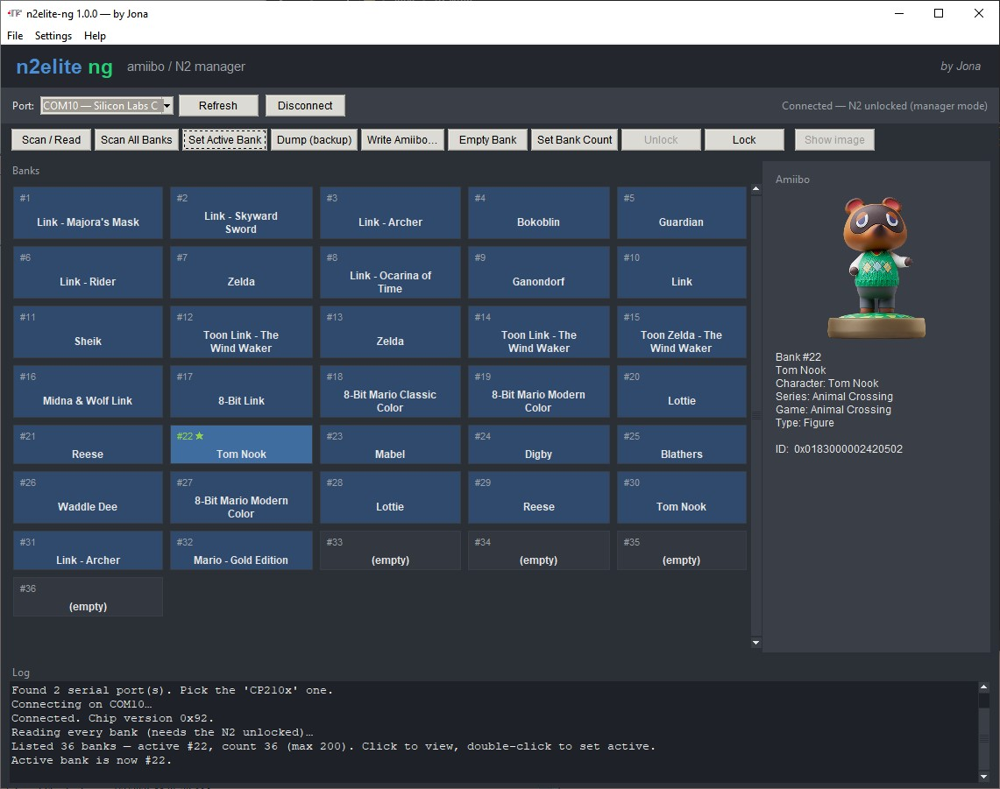

# N2Elite-ng

An open-source, cross-platform (Windows / Linux / macOS) manager for the
**N2 Elite / Amiiqo USB reader-writer** — a modern, fully offline replacement for
the abandoned "N2 Manager" application.



*The n2elite-ng graphical manager on Windows — connected to an unlocked N2, showing
the amiibo bank grid, the per-amiibo detail panel, and the activity log.*

> Status: **complete and proven on real hardware** — read, identify, back up,
> write, and full multi-bank management (dump/restore, set active bank, set bank
> count, lock/unlock). Amiibo encrypt/decrypt works offline. Multi-bank management
> needs the disc unlocked into manager mode. See `NOTES.md` and `docs/`.

## Features
- **Talk to the dongle** over its serial (CP210x/MFRC522) link — auto-detected.
- **Read / back up** the active tag to a standard NTAG215 `.bin`.
- **Amiibo crypto** (`decrypt` / `encrypt`) using *your own* `key_retail.bin`
  (à la TagMo/amiitool) — fully offline.
- **N2 management** (bank list/dump, set bank count, select bank, lock/unlock,
  write) — implemented; requires the N2 disc unlocked into manager mode.
- **Fully-offline option**: bundled amiibo name database, plus an optional one-time
  `sync` to download the whole database and every figure image so nothing is
  fetched later.

## Install & build (Make)
The Python package is the base; a Tkinter **GUI** (styled after the original
N2 Manager) and native binaries are built from it.

```bash
make install        # set up ./.venv and install the app + deps
make gui            # launch the graphical app
make run ARGS="read -o tag.bin"   # run the CLI
make test           # run the offline test suite
make build-linux    # -> dist/n2elite-ng         (standalone, no Python needed)
make build-windows  # -> dist/windows/n2elite-ng.exe  (via Wine; see tools/build_windows.sh)
make clean
```
The build produces **two** binaries: `n2elite-ng` — a **windowed GUI** app (no console
window; double-click to run) — and `n2elite-ng-cli` — a console CLI for terminals/scripts
(run it with no arguments and it opens the GUI).

`make install` installs the package into the project's local `./.venv` — it does **not**
modify your system `PATH` or shell config. That creates two commands *inside the venv*,
`n2elite-ng` (the **CLI**) and `n2elite-ng-gui` (the **GUI**); run them as
`./.venv/bin/n2elite-ng …` (or after you activate the venv). Prefer the standalone
binaries above if you don't want a Python environment at all.

> Note the naming: the double-click **binary** `n2elite-ng` is the GUI, while the
> venv **command** `n2elite-ng` is the CLI. Most people use only one.

**Native binaries for both OSes:** `make build-linux` builds on Linux;
`make build-windows` cross-builds via **64-bit** Wine using a portable Python —
no 32-bit Wine libraries or host changes needed (see `tools/build_windows.sh`).
The most reliable path is the included CI workflow
(`.github/workflows/build.yml`), which builds genuine Linux **and** Windows
binaries on their own runners.

Linux serial access: add your user to the `dialout` group
(`sudo usermod -aG dialout $USER`, then re-login) rather than running as root.

## Usage
```bash
n2elite-ng gui                         # launch the graphical app
n2elite-ng ports                       # list serial ports
n2elite-ng info                        # identify the tag on the reader
n2elite-ng read -o mytag.bin           # dump the active tag (540-byte NTAG215)
n2elite-ng monitor                     # watch for a tag (hold connection open)
n2elite-ng unlock                      # unlock a locked N2 Elite (press its button)
n2elite-ng backup                      # dump all N2 banks (needs unlocked N2)
n2elite-ng decrypt -k key_retail.bin in.bin out.bin   # offline amiibo decrypt
n2elite-ng encrypt -k key_retail.bin in.bin out.bin   # offline amiibo encrypt
n2elite-ng identify mytag.bin          # name the amiibo in a .bin (offline)
n2elite-ng sync                        # download the full amiibo DB + all images
```
`read` also prints the amiibo name (e.g. "Link - Archer") using a bundled,
offline name database of public amiibo IDs. In the GUI, **Show image** (opt-in)
fetches and caches the amiibo's figure picture; every button has a hover tooltip
explaining it.

### Going fully offline
By default identification works offline (bundled database), and images are the
only thing fetched on demand. To remove that last online dependency, run
`n2elite-ng sync` (or **Settings → Download all images / Update database** in the
GUI). It downloads the latest amiibo database and pre-caches every figure image
into your cache folder — securely (HTTPS, size-capped, validated) and efficiently
(bounded parallel downloads, already-cached files skipped). Afterwards the app
needs no network at all. `sync --database-only` / `--images-only` do just one.

## Design principles
- **Offline by default.** No telemetry and no network calls except two opt-in,
  download-only features (image fetch and `sync`) — nothing ever leaves your machine.
- **Your keys stay yours.** `key_retail.bin` is never bundled, transmitted, or
  logged (it is git-ignored). This project ships **no** Nintendo keys or amiibo data.
- **Safety first.** Reads are non-destructive; writes are gated and back up first.

## Hardware
N2 Elite / Amiiqo USB stand: NXP MFRC522 NFC frontend driven at the register level
over a Silicon Labs CP2102 USB-UART bridge (VID:PID `10c4:ea60`), 9600→921600 baud.
Protocol details in `docs/PROTOCOL.md` (reverse-engineered from the original app).

## About
**N2Elite-ng** ("ng" = next generation) is a from-scratch, open-source manager for
the N2 Elite / Amiiqo USB dongle, built by **Jona** after the original vendor and
its "N2 Manager" software disappeared. The serial and multi-bank protocol was
reverse-engineered from the abandoned app and cross-checked against TagMo, then
reimplemented as a clean, cross-platform Python app (CLI + Tkinter GUI) that runs
fully offline and ships no Nintendo keys. It reads, backs up, identifies, and
manages amiibo banks on hardware you own. In the app, see **Help → About** for
version and license info.

## License & credits
By **Jona**. Licensed under **PolyForm Noncommercial 1.0.0** (see `LICENSE`) —
free to use, modify, and share, but **not for commercial profit**.

For personal backup/interoperability with hardware you own. Supply your own
`key_retail.bin` dumped from your own console. This project ships **no** Nintendo
keys or amiibo data. Third-party attributions in `THIRD_PARTY_NOTICES.md`.

Built by reverse-engineering the device and porting concepts from open sources — full credits in [`docs/SOURCES.md`](docs/SOURCES.md) and [`THIRD_PARTY_NOTICES.md`](THIRD_PARTY_NOTICES.md).
